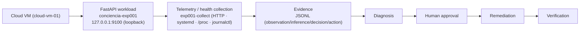

# EXP-001 — Controlled Cloud Reliability Loop

**Conciencia AI Labs · EXP-001 (CloudOps real)**

- **Versión del experimento:** v0.2 (CloudOps).
- **Fecha de ejecución:** 2026-10-06, 02:58–03:11 UTC (≈ 2026-10-05 23:58 → 2026-10-06 00:11 America/Asuncion).
- **Estado:** **PASS** (con un gate secundario marcado **PARTIAL**, ver *Limitaciones*).
- **Revisión del repo del Lab (base):** `96edfd4`.
- **Entorno:** Linux cloud VM (Hetzner), host anonimizado como `cloud-vm-01`. Ubuntu 26.04 LTS, kernel 7.0.0-15, 2 vCPU, 3.7 GiB RAM, sin swap, 19 GiB libres.
- **Workload:** servicio **FastAPI** aislado `conciencia-exp001` (`GET /health`), bind **solo loopback** `127.0.0.1:9100`, ejecutado con **systemd**.

> **Aviso.** Experimento **pequeño y controlado**. **No** representa infraestructura GPU, **no** representa una AI Factory en producción, **no** prueba operación a escala. El fallo fue **intencional y autorizado** por un humano antes de ejecutarse. La VM es **compartida**; EXP-001 corrió **aislado** (usuario, directorio, unit systemd y puerto propios; sin exponer puerto, sin tocar el reverse proxy ni otros servicios).

## Objetivo

Validar en infraestructura cloud real el circuito:

```
telemetría → evidencia → detección → diagnóstico → propuesta de remediación
→ aprobación humana → acción → verificación
```

## What this proves

En una VM cloud real, EXP-001 demostró —con evidencia verificable— que se puede:

- **observar** un workload (health, latencia, estado, PID, uptime, RSS/CPU, logs);
- **detectar** su indisponibilidad (health no responde, unit `inactive/dead`, sin listener);
- **capturar evidencia estructurada** (JSONL, con observación / inferencia / decisión / acción separadas);
- **diagnosticar** a partir de esa evidencia (causa raíz `SERVICE_STOPPED`);
- obtener **aprobación humana antes** de la recuperación;
- **remediar** (levantar el workload);
- **verificar** después (health 200 y comparación BEFORE / INCIDENT / AFTER).

## What this does not prove

Sin exagerar el alcance:

- **No** es infraestructura GPU ni una AI Factory en producción.
- **No** prueba operación a escala (un único workload, una única falla).
- El incidente fue **intencional y controlado** (provocado por el operador).
- **No** prueba recuperación ante una falla **espontánea** no planificada.
- El **approval gate genérico de Conciencia para acciones de SO todavía no está integrado**: la aprobación humana de esta ejecución quedó registrada como **decisión real**, pero el gate sigue **PARTIAL**. No se oculta.
- **No** se reutilizó Decision Memory; no se convirtió el PARTIAL en PASS artificialmente.

## Arquitectura mínima



Solo los componentes que participaron realmente. Sin Kubernetes, sin GPU, sin base de datos, sin plataforma de observabilidad: únicamente herramientas nativas de Linux.

- `conciencia-exp001.service` (systemd, usuario `exp001`, `Restart=no` **a propósito**: un servicio detenido debe quedar caído para que el fallo sea observable y no lo oculte un auto-heal).
- `exp001-collect`: colector de señales nativas.
- Evidencia en `/opt/conciencia-exp001/evidence/` (copia pública sanitizada en `evidence/EXP-001/`).

## Procedimiento reproducible

```bash
# Estado / baseline
systemctl is-active conciencia-exp001
curl -s -o /dev/null -w 'http=%{http_code} time=%{time_total}s\n' http://127.0.0.1:9100/health
runuser -u exp001 -- exp001-collect before      # -> evidence/before.jsonl

# FALLO CONTROLADO (solo con aprobación humana explícita)
systemctl stop conciencia-exp001
runuser -u exp001 -- exp001-collect incident    # -> evidence/incident.jsonl

# REMEDIACIÓN (solo con aprobación humana explícita)
systemctl start conciencia-exp001
runuser -u exp001 -- exp001-collect after       # -> evidence/after.jsonl
```

Runbook completo (provisión del workload, unit systemd, colector) en la sección *Runbook*.

## Resultados — BEFORE / INCIDENT / AFTER

| Campo | BEFORE | INCIDENT | AFTER |
| --- | --- | --- | --- |
| service_state | active / running | **inactive / dead** | active / running |
| main_pid | 2447403 | **0** | 2453075 |
| http_status | 200 | **0 (connection refused)** | 200 |
| latency_ms | 10.14 / 14.33 / 16.03 | — | 10.08 / 11.21 / 13.28 |
| rss_kb | ~56.4k | — | ~55.7k |
| listener 9100 | sí | **no** | sí |

**Diagnóstico:** causa raíz `SERVICE_STOPPED` — indisponibilidad por parada intencional (`systemctl stop`), no un crash (apagado *graceful* en journal). Confianza: alta.

## Limitaciones

- Experimento **pequeño**; no representa GPU ni AI Factory en producción.
- Fallo **intencional y controlado**, no espontáneo.
- **Approval gate = PARTIAL**: no hay gate genérico para autorizar acciones de SO; la aprobación humana corrió por canal de operador y quedó registrada en `loop.jsonl`. Integrar Decision Memory / gate genérico queda como próximo paso.
- Telemetría de proceso vía `/proc`/`ps`; sin métricas históricas ni alerting automático.
- VM sin swap (válido para este workload mínimo).

## Rollback

```bash
# Detener sin desinstalar (estado actual recomendado)
systemctl stop conciencia-exp001

# Teardown completo (no ejecutado)
systemctl disable --now conciencia-exp001
rm /etc/systemd/system/conciencia-exp001.service
systemctl daemon-reload
rm -rf /opt/conciencia-exp001 /usr/local/bin/exp001-collect
```

## Evidencia utilizada

Copia pública sanitizada en `evidence/EXP-001/`:

- `before.jsonl` (3 muestras) — baseline saludable.
- `incident.jsonl` (3 muestras) — incidente.
- `after.jsonl` (3 muestras) — recuperación.
- `loop.jsonl` — inferencia (diagnóstico), 2 decisiones humanas y acciones ejecutadas.

Evidencia cruda en `/opt/conciencia-exp001/evidence/` (host no publicado).

## Runbook (provisión)

```bash
BASE=/opt/conciencia-exp001
useradd --system --no-create-home --shell /usr/sbin/nologin exp001
python3 -m venv "$BASE/.venv"
"$BASE/.venv/bin/pip" install fastapi "uvicorn[standard]"

cat > /etc/systemd/system/conciencia-exp001.service <<'UNIT'
[Unit]
Description=Conciencia AI Labs EXP-001 controlled workload (FastAPI)
After=network.target
[Service]
Type=simple
User=exp001
Group=exp001
WorkingDirectory=/opt/conciencia-exp001
ExecStart=/opt/conciencia-exp001/.venv/bin/uvicorn app.main:app --host 127.0.0.1 --port 9100
Restart=no
[Install]
WantedBy=multi-user.target
UNIT
systemctl daemon-reload
systemctl enable --now conciencia-exp001
```

---

_Fuente de la verdad de esta iteración. Documento del Lab; publicado con aprobación del operador. No incluye IPs, hostnames reales, usuarios del operador ni información de otros servicios._
