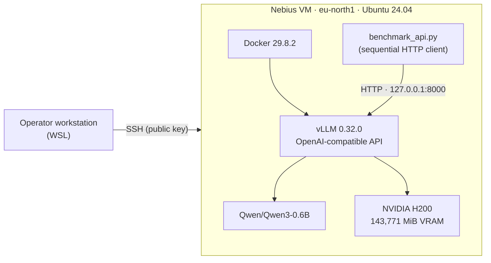

# EXP-003 — NVIDIA H200 GPU Inference on Nebius AI Cloud

**Technical report · Session 001**
**Status:** completed · **Reality:** `REAL` · **Report date:** 2026-10-19
**Author:** Conciencia AI Labs

---

## Executive summary

EXP-003 validates a minimal, auditable GPU inference path on Nebius AI Cloud:
one NVIDIA H200 instance, CUDA 13.0, PyTorch 2.13.0+cu130, NVIDIA DCGM 4.7.0,
Docker with GPU access, vLLM 0.32.0 and the model `Qwen/Qwen3-0.6B`, exposed
through an OpenAI-compatible HTTP API bound to loopback.

The experiment demonstrated that:

- the H200 is correctly recognized by the driver and usable from CUDA,
  PyTorch, DCGM and a Docker container;
- vLLM serves the model and returns valid OpenAI-shaped responses;
- a 10-request sequential benchmark produced **1,163 output tokens**, a mean
  end-to-end latency of **0.20773 s** and an aggregate **559.86 output tokens/s**.

This is an engineering validation on a single GPU with a 0.6B model. It does not
measure the maximum throughput of an H200, does not evaluate model quality and
does not compare providers. The VM was stopped at the end of the session.

---

## Experimental objectives

| # | Objective | Success criterion | Outcome |
| --- | --- | --- | --- |
| 1 | Provision a Nebius H200 instance | Instance reachable via SSH | Met |
| 2 | Validate GPU, CUDA, PyTorch and DCGM | Tools execute on the GPU; DCGM level 1 passes | Met |
| 3 | Validate GPU access from Docker | Container sees the GPU | Met |
| 4 | Serve a model with an OpenAI-compatible API | `/health`, `/v1/models`, chat completion succeed | Met |
| 5 | Measure a small sequential workload | Persisted per-request latency and token counts | Met |
| 6 | Preserve evidence and stop the VM | Sanitized evidence published; VM `STOPPED` | Met |

**Out of scope:** maximum throughput, concurrency, multi-node, multi-GPU,
model quality, SLA, cost optimization, provider benchmarking.

---

## Infrastructure

| Component | Observed value | Source |
| --- | --- | --- |
| Provider / region | Nebius AI Cloud · `eu-north1` | Session record |
| GPU | NVIDIA H200 NVLink, 1 GPU | `nvidia-smi` |
| VRAM | 143,771 MiB (~140.4 GiB; marketed as ~141 GB) | `nvidia-smi` |
| GPU power cap | 700 W | `nvidia-smi` |
| vCPU | 16 | Session record |
| RAM | 196 GiB visible (~200 GiB provisioned) | `gpu-baseline.txt` |
| Root disk | 96 GiB visible (~100 GiB provisioned SSD) | `gpu-baseline.txt` |
| OS / kernel | Ubuntu 24.04 LTS · 6.11.0-1016-nvidia | `gpu-baseline.txt` |
| NVIDIA driver | 580.173.02 | `nvidia-smi` |
| CUDA | 13.0 (`cuda-toolkit==13.0.3.0`) | `nvidia-smi`, `python-packages.txt` |
| PyTorch | 2.13.0+cu130 | `python-packages.txt` |
| NVIDIA DCGM | 4.7.0 | `dcgm-level1.txt` |
| Docker | 29.8.2 (operator record) | Session record |
| NVIDIA Container Toolkit | Installed and working | Docker GPU test |
| vLLM | 0.32.0 | `vllm.log`, image labels |
| Model | `Qwen/Qwen3-0.6B` | `vllm.log`, inference JSON |

The instance was provisioned through the Nebius console. **No Terraform,
Pulumi or cloud-init automation was used in Session 001.** The reproducible
automation in `infra/` is proposed and explicitly marked as untested.

---

## Architecture



The HTTP client and the vLLM container run on the same VM. The container port
is published **only on host loopback** (`127.0.0.1:8000`); it is not exposed to
the public internet.

---

## Networking and security

| Control | Implementation |
| --- | --- |
| SSH | Public-key authentication; no password login used |
| Security Group | Dedicated group with restricted access (operator record) |
| Inference port | `127.0.0.1:8000` on the host; `0.0.0.0:8000` only inside the container network namespace |
| Public inference | None. No public endpoint or live demo was published |
| Evidence transport | Copy from the VM to the operator workstation, then sanitization before publication |
| Credentials in evidence | None found: no API keys, SSH private keys, tokens or passwords |

`vllm-inspect.json` confirms the host port binding:

```json
"PortBindings": {
  "8000/tcp": [{ "HostIp": "127.0.0.1", "HostPort": "8000" }]
}
```

Internal infrastructure identifiers (tenant, project, instance hostname, GPU
serial/UUID/PDI, container ID, bridge IPs) were removed from the public
evidence. See [`../evidence/public/README.md`](../evidence/public/README.md).

---

## GPU validation

| Check | Command / artifact | Observed result |
| --- | --- | --- |
| GPU inventory | `nvidia-smi` | H200, 143,771 MiB, driver 580.173.02, CUDA 13.0 |
| GPU baseline | `gpu-baseline.txt` | 41 °C, 80 W / 700 W, 0 MiB used, no processes |
| CUDA Toolkit | `nvcc --version` | CUDA 13.0 (operator record; toolkit package 13.0.3.0 in `python-packages.txt`) |
| PyTorch CUDA | CUDA tensor operation | Passed (operator record; stdout not persisted) |
| DCGM level 1 | `dcgmi diag -r 1` | **PASS** — software: Pass, GPU0: Pass |
| Docker GPU | `docker run --gpus all ... nvidia-smi` | GPU visible inside container (operator record) |
| GPU after workload | `nvidia-smi` | 40 °C; vLLM process using 131,792 MiB |

**Evidence gap:** the stdout of the PyTorch CUDA operation and the `docker run`
GPU check was not saved as a file. The installed `torch==2.13.0+cu130` and the
running vLLM process using GPU memory support the claim, but Session 002 should
persist those two command outputs explicitly.

---

## Model serving

| Parameter | Value |
| --- | --- |
| Engine | vLLM 0.32.0 |
| Container image | `vllm/vllm-openai@sha256:befccf0e7e4089aa23926bb6f887a85c0d46c2a99e6de5c5ffdf5cb7957c5b34` |
| Local image digest | `sha256:bd8a5d7a8774800c92d714c0c226b32c1863f929150f36efd610aebcd12a335d` |
| Model | `Qwen/Qwen3-0.6B` |
| `max_model_len` | 4096 |
| Tensor parallel | 1 |
| Precision | `torch.bfloat16` |
| Attention backend | FlashAttention 3 |
| KV cache | 1,176,512 tokens (max concurrency 287.23× at 4,096 tokens/request) |
| Host binding | `127.0.0.1:8000` |
| Model weights | ~1.40 GiB (EXT4, downloaded during startup) |

The container was started with:

```bash
docker run --rm --gpus all --name exp003-vllm \
  -p 127.0.0.1:8000:8000 \
  -v "$HOME/exp003/models-cache:/root/.cache/huggingface" \
  vllm/vllm-openai@sha256:befccf0e7e4089aa23926bb6f887a85c0d46c2a99e6de5c5ffdf5cb7957c5b34 \
  --model Qwen/Qwen3-0.6B --max-model-len 4096
```

A single persisted chat completion is in
[`../evidence/public/session-001/evidence/qwen3-inference.json`](../evidence/public/session-001/evidence/qwen3-inference.json).
It returned `finish_reason: "stop"`, 252 completion tokens and the model name
echoed as `Qwen/Qwen3-0.6B`.

---

## Benchmark methodology

**Script:** [`../benchmarks/benchmark_api.py`](../benchmarks/benchmark_api.py)
(derived from the original `benchmark_api.py` used in Session 001).

| Parameter | Value |
| --- | --- |
| Endpoint | `http://127.0.0.1:8000/v1/chat/completions` |
| Requests | 10, sequential |
| Client concurrency | 1 |
| Warm-up requests | 0 |
| `max_tokens` | 128 |
| `temperature` | 0.6 |
| Thinking mode | Disabled (`chat_template_kwargs.enable_thinking = false`) |
| Prompt | "Explica brevemente el concepto N: inferencia de modelos de IA en GPUs." |
| Latency measurement | `time.perf_counter()` around the full HTTP round-trip |
| Output tokens | `usage.completion_tokens` from the response |
| Aggregate throughput | `sum(output_tokens) / sum(latency_seconds)` |
| Mean latency | Arithmetic mean of the 10 per-request latencies |

No warm-up request was issued. The first request may include one-time runtime
or connection overhead; the report does not correct for it.

---

## Results

### Per-request observations

| # | Latency (s) | Output tokens | Tokens/s (e2e) | `finish_reason` |
| ---: | ---: | ---: | ---: | --- |
| 1 | 0.2437 | 127 | 521.16 | `stop` |
| 2 | 0.2265 | 128 | 565.22 | `length` |
| 3 | 0.1935 | 108 | 558.12 | `stop` |
| 4 | 0.1704 | 95 | 557.64 | `stop` |
| 5 | 0.2253 | 128 | 568.05 | `length` |
| 6 | 0.2076 | 118 | 568.44 | `stop` |
| 7 | 0.2255 | 128 | 567.58 | `length` |
| 8 | 0.2265 | 128 | 565.17 | `length` |
| 9 | 0.1682 | 95 | 564.96 | `stop` |
| 10 | 0.1901 | 108 | 568.11 | `stop` |

### Aggregates

| Metric | Value |
| --- | ---: |
| Total output tokens | 1,163 |
| Sum of per-request latencies | 2.0773 s |
| Mean latency | **0.20773 s** |
| Aggregate output throughput | **559.86 tokens/s** |
| `finish_reason` distribution | 6 `stop`, 4 `length` |

These values were re-computed from the persisted JSON and match the source
file (`qwen3-0.6b.json`).

### Interpretation

- The endpoint is functional and stable for short single-stream requests.
- Latency is consistent (0.168–0.244 s); the first request is the slowest.
- Throughput is **aggregate end-to-end output throughput**, not the H200's
  maximum capability and not a decode-only measurement.
- Four requests stopped at `max_tokens=128`; their content is truncated. They
  are valid HTTP completions but not complete answers.
- A 0.6B model on an H200 is heavily under-utilized. The result characterizes
  the end-to-end path, not the hardware ceiling.

---

## Cost analysis

| Item | Value |
| --- | --- |
| Observed session spend (operator report) | ~USD 1.70 |
| Reported session duration | ~55 minutes |
| Arithmetic average | ~USD 1.85/h |
| Spot maximum price policy | USD 2.70 per GPU-hour (ceiling policy, not a session cap) |
| Billing reconciliation | Pending; no detailed invoice breakdown was available |

The USD 1.85/h figure is an arithmetic average of a short session, not a
contractual rate or a projection. Spot billing is variable and may include
compute, storage, network/IP, discounts and taxes. The managed disk may continue
to be billed while the VM is `STOPPED`. See the dedicated
[cost and lifecycle report](EXP-003-COST-AND-LIFECYCLE.md).

---

## Limitations

- **Single GPU, single node, single model.** No multi-GPU or multi-node test.
- **Sequential only.** No concurrency, no batching study, no queueing behavior.
- **No TTFT measurement.** Latency is end-to-end wall-clock; time-to-first-token
  was not isolated.
- **No warm-up.** The first request includes potential cold-start effects.
- **No fixed seed.** Temperature 0.6; outputs are not deterministic.
- **Truncated outputs.** 4 of 10 requests hit `max_tokens=128`.
- **No quality evaluation.** The benchmark says nothing about answer accuracy.
- **No provider comparison.** Crusoe is a later, separate experiment.
- **Evidence gaps.** PyTorch and Docker GPU command outputs were not persisted;
  vCPU count and Docker version come from the session record.
- **Cost is reported, not reconciled.** No billing export was analyzed.

---

## Reproducibility

Exact prerequisites and commands are in
[EXP-003 — Reproducibility](EXP-003-REPRODUCIBILITY.md). Summary:

```bash
# On the GPU VM
./scripts/validate-gpu.sh
./scripts/docker-run.sh
./scripts/validate-inference.sh

# In another shell on the same VM
python3 benchmarks/benchmark_api.py --output qwen3-0.6b.json
```

The historical procedure (console provisioning + SSH + Docker) is distinguished
from the proposed automation. No Terraform or cloud-init was used or validated.

---

## Evidence provenance

| Claim | Backing |
| --- | --- |
| H200, VRAM, driver, CUDA, power, temperature | `nvidia-smi-full.txt`, `gpu-baseline.txt` |
| DCGM level 1 PASS | `dcgm-level1.txt` |
| CUDA/PyTorch package versions | `python-packages.txt` |
| vLLM version, model, engine configuration | `vllm.log`, `vllm-inspect.json` |
| Image identity | `vllm-image-digest.json`, `vllm-image-id.txt` |
| One successful inference | `qwen3-inference.json` |
| Benchmark metrics | `benchmarks/qwen3-0.6b.json` |
| Disk usage after model download | `storage.txt` |
| Session end time | `session-ended-utc.txt` |
| vCPU count, Docker version, PyTorch CUDA stdout, Security Group details | Session record (not persisted as files) |
| Cost | Operator report (not reconciled with Billing) |

---

## Next steps — Session 002

1. Repeat with 8B and 14B models to observe the effect of model size.
2. Add concurrency (fixed request rate and closed-loop) and measure p50/p95.
3. Measure TTFT and inter-token latency separately.
4. Use vLLM's own benchmark tooling for a comparable throughput baseline.
5. Persist the stdout of every validation command, including PyTorch and Docker.
6. Add a FastAPI gateway in front of vLLM and integrate it with the Conciencia
   harness.
7. Run a later comparison with Crusoe Cloud using the same methodology.
8. Reconcile cost with the provider's billing export.

---

## References

- [EXP-003 — Cost and lifecycle](EXP-003-COST-AND-LIFECYCLE.md)
- [EXP-003 — Reproducibility](EXP-003-REPRODUCIBILITY.md)
- [Public evidence](../evidence/public/README.md)
- [Sanitization report](../evidence/public/sanitization-report.json)
